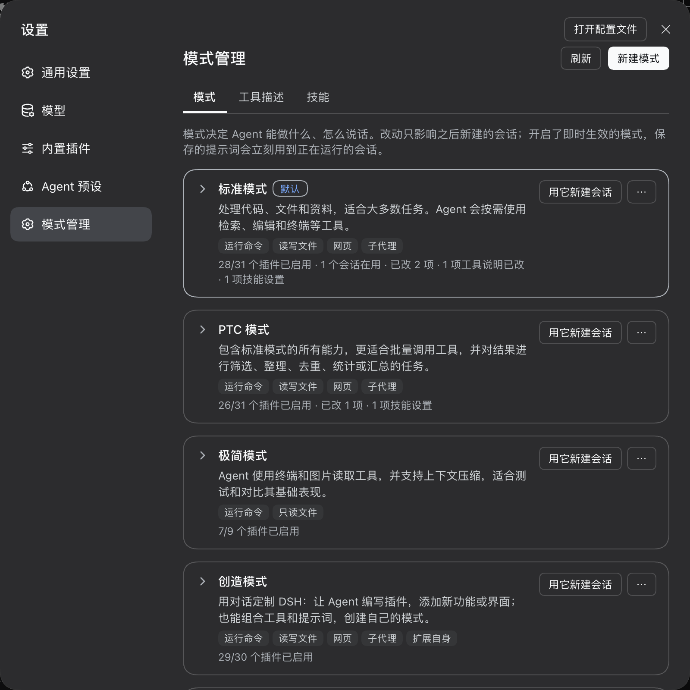

# dsh-modes · 模式管理

[English](https://github.com/xiaohai-78/dsh-modes/blob/main/README.md) | 中文

给 [DeepSeek Harness](https://github.com/deepseek-ai/deepseek-harness)（dsh）的 Web 界面加一个「模式管理」设置页：用开关决定每个模式能做什么，按模式编辑系统提示词，用模板新建自己的模式，dsh 升级后一键合并官方更新。



## 它能帮你做什么

- **看懂每个模式**：每个模式一张卡片，标出它能做的事（运行命令、读写文件、上网、子代理……），不用展开就能比较。
- **用开关决定能力**：15 项能力各一个开关，比如关掉「运行命令」，或者把文件设成只读。不用面对几十个插件名。
- **改提示词**：按模式编辑系统提示词，可以预览、保留历史版本；还可以让改动立刻作用到正在运行的会话，或者允许模型在对话里改（每次保存都要你批准）。
- **新建自己的模式**：从「开发、写作、聊天、只读调研」四个模板起步，或者复制任意现有模式。
- **跟上 dsh 升级**：dsh 更新内置模式后，一键把官方的变化合并进来，同时保留你的修改；有插件加载失败时，一键关掉出问题的那几个。

## 安装

需要 dsh 的 Web 界面（`dsh web`），兼容的版本见[兼容性](#兼容性)。

```bash
dsh plugin --profile web add dsh-modes
```

如果你是从 dsh 源码运行的，在源码目录里把命令换成 `pnpm dsh plugin --profile web add dsh-modes`。装好后重新启动 `dsh web`，打开 **设置 → 模式管理**。

## 快速上手

1. 打开 **设置 → 模式管理**，看看内置的几个模式：卡片上的小标签就是它们能做的事。
2. 点右上角 **新建模式**，选「只读调研」，直接点创建。
3. 新模式的卡片会展开到「能力」页：「运行命令」是关的，「文件」打开但「允许修改文件」是关的。
4. 点卡片上的 **用它新建会话**，让它改一个文件：这个模式里没有写文件、编辑文件或运行命令的工具，它只能读和搜索。
5. 回到这张卡片的「提示词」页，改一句提示词并保存。新开的会话就会用上它；想让正在运行的会话也立刻用上，打开下方的「即时生效」。

## 功能说明

### 模式列表

每个模式一张卡片：

- **卡片头**：名称和描述，以及「默认」「自定义」标记。
- **能力标签**：它能做的事，例如「运行命令 · 只读文件 · 网页」。
- **状态行**：已启用的插件数、有几个会话在用、改过几项，以及是否开了即时生效。
- **按钮**：「用它新建会话」用这个模式开一个新会话。「⋯」菜单里是其他操作：设为默认、复制、查看配置（YAML）、编辑信息、恢复内置、删除。
- **提示条**：有需要你处理的事时，卡片上会出现一条，例如「内置模式有更新」「有插件加载失败」「有未保存的提示词草稿」，并带处理按钮。

点卡片可以展开，里面有「能力」「提示词」「全部插件」三个标签页。

### 能力

| 分组 | 能力 |
|---|---|
| 能做的事 | 运行命令、文件（可单独关掉「允许修改文件」）、网页、子代理与工作流、扩展自身（插件管理、插件市场、插件接口查询） |
| 工作方式 | 计划模式、待办清单、会话目标、技能、向你提问、交付文件、定时提醒 |
| 上下文 | 工作区指令（AGENTS.md、CLAUDE.md 等）、时间感知、上下文压缩 |

- **打开**一项能力，会把它恢复成内置模式里的样子：按运行环境自动开关的插件（例如 Bash 和 PowerShell）恢复成「自动」；官方本来就关着的插件（例如 Codex 子代理）仍然关着。
- **关闭**一项能力，会关掉它包含的所有插件。
- 只开了一部分插件的能力会标「部分开启」。
- 模式里没有的能力不会显示，例如 dsh 0.2.1 之前没有「定时提醒」。

### 提示词

- **系统提示词**：编辑这个模式的系统提示词，点按钮插入 `{{model}}` 等变量，输入时实时检查变量是否可用；「预览完整系统提示词」可以看到模型实际收到的全部内容。
- **高级设置**：结尾提示词（追加在工具说明、工作区规则之后）、「只用开头这段作为完整提示词」、「附带运行时上下文」。
- **保存**：点「保存」或按 ⌘/Ctrl + Enter。以上内容都要保存后才生效。
- **历史版本**：每次保存都会记一个版本（最多 30 个），标明是在设置页、对话中还是别处改的，任何版本都能载回编辑器。
- **导入导出**：支持导入、导出 `.md` 文件。
- **恢复内置**：「恢复内置提示词」会先问一次。
- **不怕丢**：没保存的修改会作为草稿留在浏览器里，刷新页面也不会丢；如果你编辑期间提示词在别处被改了，保存会被拒绝，并让你选择载入最新内容，或用自己的版本覆盖。

「在对话中」一栏有两个开关，**点一下就保存**，对之后新建的会话生效：

- **即时生效**：保存提示词后，正在运行的会话从下一步起就使用新提示词。
- **允许在对话里修改提示词**：你可以直接对模型说「把你的提示词改成……」。模型通过 `mode_prompt` 工具读取或修改这个模式的提示词，**每次保存前都会弹出审批**。

### 全部插件

列出模式里的每个插件，适合需要逐个调整的情况：

- 页面内可以搜索，也可以只看改动过的插件。
- 按运行环境切换的插件可以选「自动 / 开 / 关」。
- 改过的插件可以单独「还原」。
- 「详情」里能看到行 id、模块和完整配置。

### 新建模式

| 起步方式 | 开着的能力 | 适合 |
|---|---|---|
| 开发 | 与标准模式相同 | 日常写代码 |
| 写作 | 读写文件、工作区指令、待办、交付文件、技能、上下文压缩、提问、时间；**没有终端** | 写文档、改稿 |
| 聊天 | 网页、上下文压缩、提问、时间；**不碰文件和终端** | 问答、聊天 |
| 只读调研 | 读取和搜索文件、网页、工作区指令、待办、技能、上下文压缩、提问、时间；**不能改文件、不能运行命令** | 看代码、查资料 |
| 复制现有模式 | 与被复制的模式相同 | 在已有模式上微调 |

每个模板都带一段起步提示词，按界面语言选中文或英文。名称和 ID 会自动填好，之后都可以改。

### 跟上 dsh 升级

- **同步内置更新**：dsh 升级后，改过的内置模式，以及基于内置模式创建的自定义模式，会提示「内置模式有更新」。同步前会列出新增、移除和有官方更新的插件；确认后：
  - 你没动过的插件跟随官方；
  - 你改过的设置保留你的值；
  - 新增的插件在模板模式里默认关闭。
- **一键修复**：模式里有插件加载失败时，整个模式会用不了。卡片上会列出失败的插件和原因，一键只关掉这几个，模式就能恢复使用。
- **删除前提醒**：删除自定义模式前，会告诉你有多少个打开的和已保存的会话在用它；删除后，这些会话就打不开了。

## 改动什么时候生效

- 所有改动都只对**之后新建的会话**生效，正在运行的会话保持原样。唯一的例外是开启了「即时生效」的模式：它保存的提示词文字会从下一步起作用到正在运行的会话。
- 改动写在当前 dsh profile 的 `cordis.patch.yml` 里，用同一个 profile 打开的其他窗口也会看到。Desktop 应用用的是另一个 profile，不受影响。
- 每次操作的结果显示在页面底部的提示条里；出错的提示会一直留着，直到你关闭。

## 兼容性

| dsh 版本 | 结果 |
|---|---|
| `0.2.0-rc.2`（npm `latest`） | 可用。这个版本的 dsh 不提供插件的中文名，本插件会用各插件官方的中文名称代替 |
| `0.2.1-alpha.3` | 可用 |
| `0.2.1-rc.1`（npm `next`） | 可用。rc.1 给内置模式新增了插件市场工具，改过的模式会提示「内置模式有更新」，同步后加入（默认关闭） |

以上版本都实际安装测试过，包括用本地假模型检查发给模型的真实请求。插件用到的 dsh 接口还没有稳定，其他版本可能需要适配。

## 常见问题

**改了开关或提示词，但对话里没变化？**
改动只对之后新建的会话生效，用「用它新建会话」开一个新的试试。只有开启了「即时生效」的模式，提示词文字才会作用到正在运行的会话。

**dsh 升级后某个模式用不了了？**
展开那个模式的卡片，如果提示有插件加载失败，点「关闭这些插件」；如果提示「内置模式有更新」，点「同步内置更新」。

**改乱了，怎么回到原样？**
- 单个插件：在「全部插件」里点「还原」；
- 提示词：在「历史版本」里载回任意旧版本，或点「恢复内置提示词」；
- 整个内置模式：在「⋯」菜单里选「恢复内置」。

**在对话里让模型改提示词，没有反应？**
「允许在对话里修改提示词」只对打开之后新建的会话生效。另外，dsh 的审批策略如果设为「从不」（例如无人值守运行），保存会被拒绝。

**插件的数据存在哪里？**
- 模式配置：在 profile 的 `cordis.patch.yml` 里；
- 同步基准和提示词历史：在 profile 目录下的 `.dsh-modes/` 文件夹里；
- 未保存的草稿：只在当前浏览器里。

## 卸载

```bash
dsh plugin --profile web remove dsh-modes
```

卸载前请注意：

1. **先关掉两个开关**：在每个模式的「提示词」页里，关掉「在对话中」一栏的「即时生效」和「允许在对话里修改提示词」。这两个开关会在模式里放入本插件自己的模块，插件卸载后这些模式会找不到模块，无法使用。
2. **想完全还原**：把改过的内置模式「恢复内置」，并删除自己新建的模式。不这样做的话，改过的模式在卸载后仍按修改后的配置运行。
3. **清理数据**：profile 目录下的 `.dsh-modes/` 文件夹可以一并删除。

## 已知限制

- **同步依赖记录**：同步内置更新依赖上次保存时记下的内置插件列表。用 0.5.0 之前的版本改过的模式没有这份记录，第一次同步时，和官方不一致的地方都会按你的修改保留；之后每次保存都会补上记录。
- **即时生效的范围**：只作用于提示词的开头和结尾两段文字；「完整提示词」「运行时上下文」两项仍然只对新会话生效。
- **对话改提示词的范围**：`mode_prompt` 只读写提示词的开头这段。
- **会话统计**：删除前统计已保存的会话要读取每个会话的记录，会话很多时最多统计 8 秒，没统计完会显示「至少 N 个」。
- **权限**：写操作只依赖 dsh 自带的登录校验。

<details>
<summary><b>开发者参考：工作原理</b></summary>

### 组成

| 文件 | 作用 |
|---|---|
| `index.js` | 宿主端插件。提供 `POST /api/dsh-modes`，以及给另外两个模块用的 `dshModes` 服务。修改内置模式时，用 `configEditor.edit()` 在 profile 里写入该模式行的覆盖；插件的显示信息来自 `pluginInventory.list()` |
| `container.js` | 自定义模式容器：配置里保存 `presets` 列表，并对每一项调用 `agentPresets.register()` |
| `rebase.js` | 同步内置更新用的三方合并：以上次保存时的内置插件列表为基准，把你的修改合并到最新的内置列表上。冲突时保留你的值 |
| `state.js` | profile 目录下的 `.dsh-modes/state.json`（同步基准，以及自定义模式基于哪个内置模式、用了哪个模板）和 `history.json`（提示词历史）。写入时先写临时文件再替换 |
| `live-persona.js` | 即时生效用的身份行：替换模式里的 `@deepseek-ai/dsh-persona` 行，注册同样的两个提示词分段，每次组装提示词时读取最新保存的文字 |
| `prompt-tool.js` | `mode_prompt` 工具：作为一行插件放进模式里，所以只有这个模式的会话能看到它；写入前通过 `tools/pre-execute` 要求用户审批 |
| `client.js` | Web 设置页（中英文） |
| `cordis.patch.yml` | 插入 `index.js` 和 `container.js` 两个宿主端插件行 |

`/api/dsh-modes` 的动作：

- **读取**：`list`、`read`、`prompt`、`history`、`usage`；
- **插件行**：`toggle`、`followPlatform`、`applyRows`、`resetRow`；
- **整个模式**：`reset`、`sync`、`repair`、`create`、`update`、`remove`、`setDefault`；
- **提示词**：`setPrompt`、`setLive`、`setPromptTool`。

### 系统提示词

- **提示词的位置**：提示词是模式里身份行的 `prefix`（开头）和 `suffix`（结尾）。`complete: true` 时，开头这段就是完整的系统提示词。
- **变量校验**：变量以当前 dsh 实际注册的为准，例如 `0.2.0-rc.2` 还有 `{{cwd}}`，`0.2.1-alpha.2` 起已移除。dsh 解析变量很严格，写错一个会让该模式的每一步都失败，所以保存前（包括在对话里保存）会检查。
- **冲突检测**：保存时会带上开始编辑时的版本；如果版本已经变了，返回 `prompt-conflict`，不会覆盖。
- **即时生效的实现**：dsh 会把新的系统提示词作为一条系统消息追加到会话历史里，而不是改写最开头的那段，所以之前缓存的提示词前缀仍能命中。这个变化会记录在会话日志里。

### 验证方式

- **测试环境**：每个兼容版本都用隔离的 `DSH_HOME` 安装测试。
- **请求检查**：用 dsh 自带的本地假模型和一个记录请求的代理，检查发给模型的真实请求：
  - 「只读调研」模式的工具列表里，没有任何写文件、编辑或终端工具；
  - 即时生效后，同一会话的下一步请求就带上了新提示词；
  - 模型调用 `mode_prompt` 时界面弹出审批，批准后下一步请求就带上了修改后的提示词。

### 测试

```bash
npm test
```

运行三方合并的单元测试。

</details>

## 许可证

[MIT](LICENSE)
